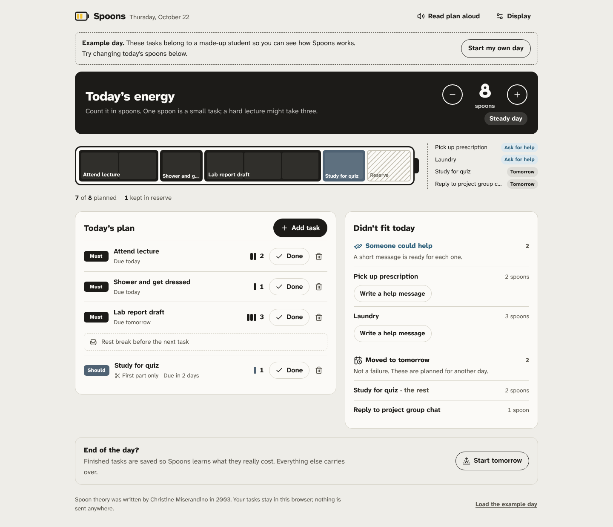

# Spoons

**Plan your day by energy, not hours.**

Spoons is a day planner for students living with a chronic illness, whose energy changes from one day to the next. Each morning you say how many *spoons* of energy you have. Spoons fits your tasks into that budget, keeps a reserve back so you don't crash, and gives everything that doesn't fit a clear next step: move it to tomorrow, do the first part, ask someone for help, or ask for more time.

Built for the [Taskforge](https://taskforge.devpost.com/) student hackathon (October 2026).



## The problem

Most to-do apps assume you have the same capacity every day. For people with conditions like sickle cell disease, long COVID, lupus or ME/CFS, that isn't true. A normal app lets you plan a 10-spoon day on a 4-spoon morning. You push through, crash, and lose tomorrow too.

Many chronically ill people already describe their energy in "spoons", from Christine Miserandino's [spoon theory](https://en.wikipedia.org/wiki/Spoon_theory) (2003). Spoons turns that language into a planner.

## What it does

- **Morning check-in.** Set today's energy from 0 to 12 spoons.
- **The battery.** Today is drawn as a battery with one cell per spoon. Tasks fill cells by priority, and a hatched reserve cell is kept back. Whatever doesn't fit spills past the tip.
- **A plan that fits.** Must-dos come first, then sooner deadlines. Big tasks that can be split get their first part planned today. Heavy tasks get a rest break after them, and two heavy tasks are never planned back to back when a lighter one can go between.
- **A next step for everything else.** Tasks someone else could do get a help message ready to copy. Must-dos that can't fit get a polite request for more time.
- **Low Power mode.** On a day of 3 spoons or fewer, the app turns yellow and plans must-dos only; everything else waits.
- **Re-plans from reality.** When you finish a task, you log what it really cost. If the lecture took 4 spoons instead of 2, the rest of the day re-plans immediately.
- **Learns your real costs.** When you add a task you've done before, Spoons suggests what it usually takes you.
- **No guilt.** Moved tasks are described as planned for another day, not as failures.

## Accessibility

Accessibility is the point of the product, so it was built in from the start:

- WCAG 2.2 AA: zero axe-core violations in light, dark, high-contrast, low-power and form-open states.
- Full keyboard use, a skip link, and visible focus everywhere.
- Screen-reader announcements whenever the plan changes ("Plan updated. 4 tasks fit today. 2 could go to someone else…"). The battery has a text description.
- Read-aloud of the whole plan (Web Speech API).
- High-contrast mode, dark mode, and an easier-reading font option (Lexend with wider spacing).
- Atkinson Hyperlegible Next, a typeface designed by the Braille Institute for low-vision readers.
- 44px minimum touch targets, phone-first layout, and support for reduced motion.
- Plain-language copy.

## Run it

```bash
npm install
npm run dev        # http://localhost:5173
npm test           # 26 planner tests (Vitest)
npm run build      # static site in dist/
```

There is no backend, no account and no API key. Tasks are saved in your browser's localStorage and are never sent anywhere. Fonts are self-hosted, so it also works offline.

To deploy: push to GitHub and enable **Settings → Pages → Source: GitHub Actions**. The included workflow builds and publishes `dist/`.

## How it works

```
src/engine/plan.ts   planDay, replan, learnCost, help and extension messages (pure functions)
src/engine/day.ts    markDone, todaysPlan, startNewDay (day state transitions)
src/App.tsx          UI: check-in, plan, overflow, add task, settings
src/components/Battery.tsx   the battery visualisation
```

The planner is a small, fully tested greedy scheduler:

1. Skip tasks already done. Usable energy is today's spoons, minus spoons already spent, minus the reserve.
2. Sort by priority (must → should → could), then deadline, then your own order.
3. For each task, in order:
   - If it fits, plan it.
   - If it doesn't fit but can be split, plan the part that fits and move the rest to tomorrow.
   - If someone else could do it, send it to "ask for help".
   - If it's a must-do, flag it as at risk.
   - Otherwise, move it to tomorrow.
4. Pace the plan: swap a lighter task between two heavy ones and add a rest break after each heavy task.

The engine was written test-first. `npm test` covers fitting, the reserve, priority and deadline ordering, splitting, help routing, at-risk flags, zero-energy days, pacing, re-planning after a costly task, learned costs and day rollover.

## Limitations

- The planner is greedy, not optimal. It respects priority over packing as much as possible, which is intentional but means a lower-priority task can use spoons a larger must-do couldn't.
- Energy costs are self-reported estimates. Spoons learns from your logs but can't measure fatigue.
- Data lives in one browser, with no sync between devices.
- Not medical advice, and not a replacement for care from a clinician.
- Tested with automated accessibility checks and keyboard walkthroughs, not yet with chronically ill users. That is the most important next step.

## Credits and disclosure

- Built by [trovic1](https://github.com/trovic1) during the Taskforge hackathon (22–24 October 2026). No code existed before the event.
- **AI assistance:** the project was built with Claude (Anthropic) as a coding and writing assistant, used for research, planning, code, tests, the demo recording script and documentation drafts. All of it was reviewed, run and tested before submission.
- The persona "Ada" and all example tasks are a fictional composite. No real person's health information is used.
- Spoon theory © Christine Miserandino. Fonts: Atkinson Hyperlegible Next (Braille Institute) and Lexend, both under the SIL Open Font License. Icons: Lucide (ISC).

## License

MIT
